# REVA

REVA is a private, local-first personal assistant for one person. You talk or type to it through an animated avatar on a Windows PC and an Android phone. It keeps your money, health, training and plans in encrypted files on your own devices, and it only acts after a deterministic policy check and, for anything sensitive, a tap from you.

It is not a SaaS product. There is no REVA server. Cloud models are off until you turn them on, per domain.

> **Status (2026-11-13):** pre-release, single developer, not production-signed. Everything on this page is on `main` and passed CI unless it is marked *planned* or *needs hardware*. Evidence for each claim is in [`tests/evidence/ledger.csv`](tests/evidence/ledger.csv).

## The Android app today

<table>
  <tr>
    <td align="center">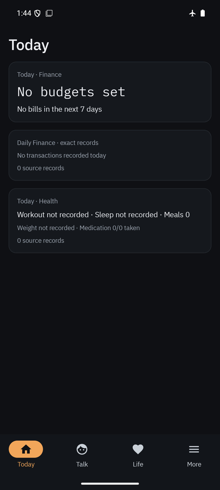<br><b>Today</b><br>Finance and Health for the day, from enabled domains only</td>
    <td align="center">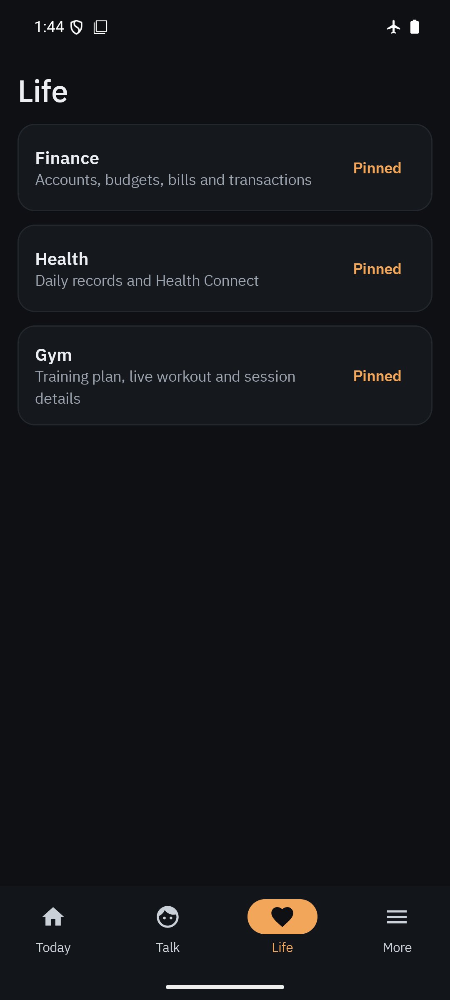<br><b>Life</b><br>One entry per built domain, up to four pinned</td>
    <td align="center">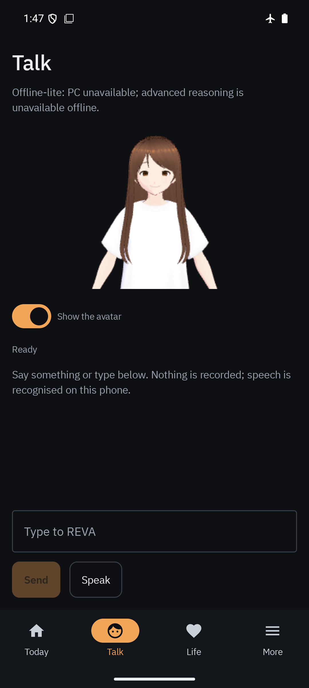<br><b>Talk</b><br>Voice or text, with the run mode always shown</td>
  </tr>
  <tr>
    <td align="center">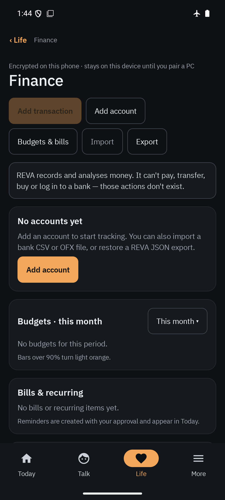<br><b>Finance</b><br>Accounts, budgets, bills, import and export</td>
    <td align="center">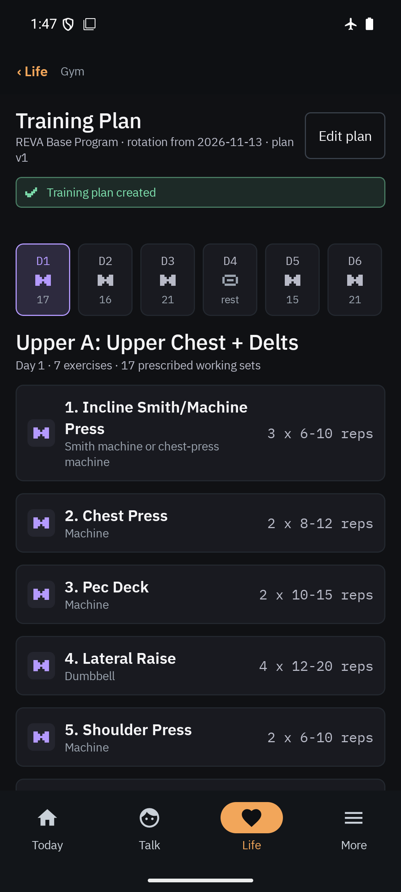<br><b>Gym</b><br>Training plan, live workout, session receipts</td>
    <td align="center">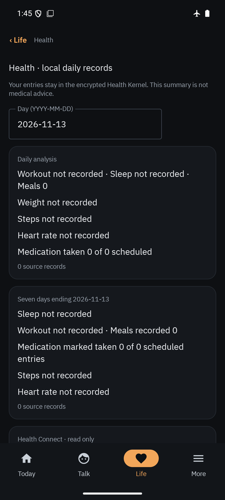<br><b>Health</b><br>Daily records and read-only Health Connect</td>
  </tr>
  <tr>
    <td align="center">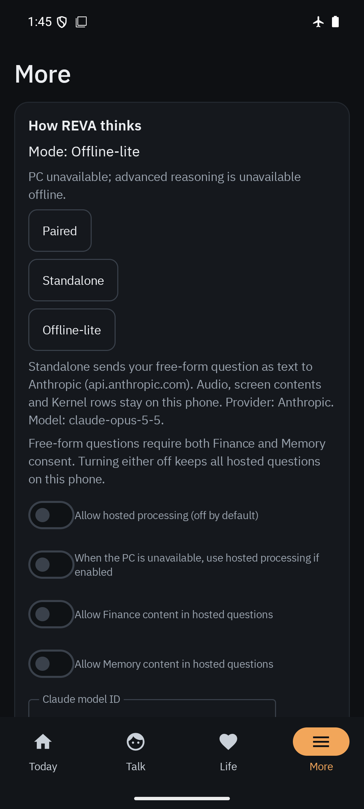<br><b>More</b><br>Paired, Standalone or Offline-lite; hosted model is opt-in</td>
    <td align="center">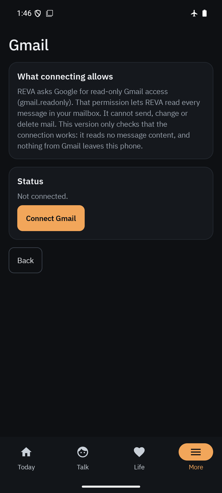<br><b>Gmail</b><br>Read-only authorization, explained before you connect</td>
    <td></td>
  </tr>
</table>

Screenshots are from the debug build on an Android 16 emulator in airplane mode, with no personal data. The avatar shown is the placeholder model.

## What works

| Area | On `main` | Not yet |
|---|---|---|
| **Domain Kernel** (Rust) | Encrypted, event-sourced Finance and Health (Gym lives inside Health). One conformance suite passes natively and through the Python and Kotlin bindings. Backup, restore, CSV / OFX / JSON import, export. | Coach, Career, Learn, Cyber, Personal, Memory domains |
| **Finance** | Accounts, transactions, categories, budgets, bills, net worth, recurring charges. Credit cards, loans, internal moves and duplicate-safe ingestion in the Kernel (schema v4). | Android screens for cards and loans, monthly plan, Inbox of email candidates |
| **Health and Gym** | Manual daily records, medication adherence, read-only Health Connect steps and heart rate, training plan, live workout, session details, backup share and restore. | More Health Connect types, trends |
| **Android app** (Kotlin, Compose) | Five-destination navigation (Today, Talk, Life, More; Plan is hidden until built), local brain with Kernel-backed answers, on-device speech, avatar, pairing and LAN sync with the PC, three run modes, read-only Gmail authorization. | Gmail ingestion, notifications, signed release |
| **Windows app** (WinUI 3) | Voice loop, avatar host, Finance page, Today card, Devices page with QR pairing, approvals, settings. | Installer |
| **Core** (Python, on the PC) | Local API on `127.0.0.1`, voice pipeline (faster-whisper, Kokoro), language layer, policy broker with signed grants, pairing gateway, opt-in hosted reasoning. | OpenClaw rung, agent tool host |
| **Avatar** (three.js, three-vrm) | One web package used by both apps; mouth moves from the audio actually played. | Final avatar asset |

Not run yet on real hardware: physical phone acceptance, API 31 emulator, live Google consent for Gmail. Those rows are `NEEDS_HARDWARE` in the ledger.

## Architecture

### System

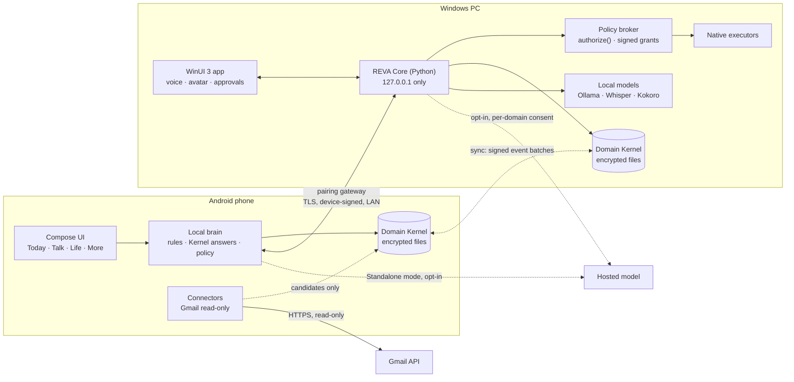

- Each device holds its own copy of every domain and works offline. Sync moves signed events over your own Wi-Fi; nothing passes through a REVA server.
- The Core listens on loopback only. A phone reaches it through the pairing gateway after a QR code, a six-digit match and an approval on the PC.
- The Kernel never opens a network connection.

### Who is allowed to do what

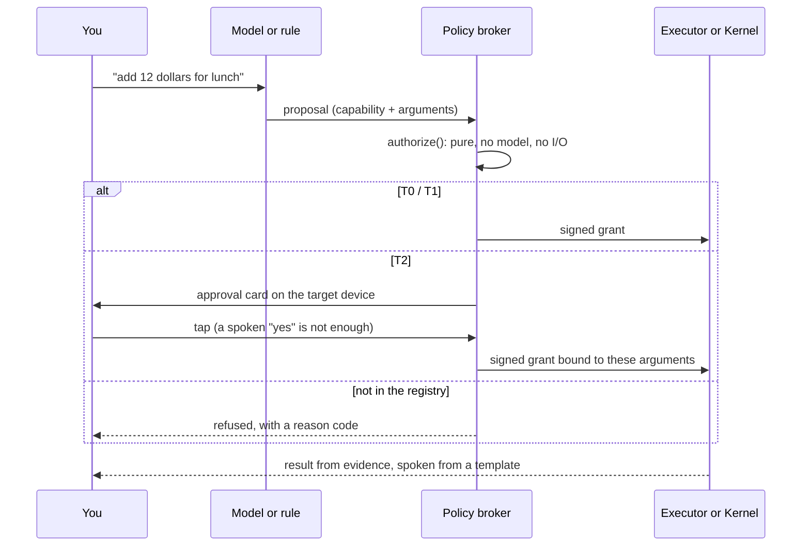

- A model may **propose**. Only the broker **authorizes**. Only executors **act**. "Done" is reported from executor or Kernel evidence, never from model text.
- The capability registry ([`contracts/capability-registry.v2.json`](contracts/capability-registry.v2.json)) is shared by the Core and the phone, so tiers are identical on both.
- These do not exist and are checked absent in CI: payments, transfers, purchases, bank logins, medical diagnosis or dosing, file deletion, sending email.
- Shell, browser control and plugins are owner-gated by decision (default off, a tap per action). They are not built; the registry still forbids them until each one's own slice changes that deliberately.

### Inside the Android app

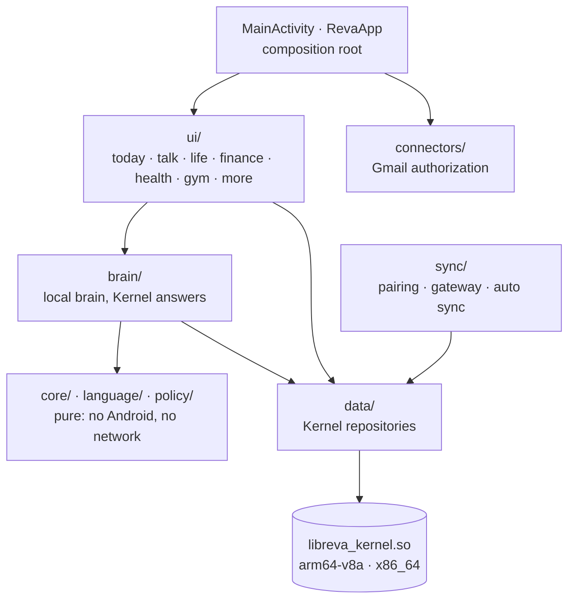

One Gradle module; packages are the boundaries. `PackageBoundaryTest` fails the build if `ui` imports the Kernel binding or a connector, if the pure packages import Android or network classes, or if `brain` and `connectors` import each other. `ManifestTest` pins the exact permission list (INTERNET, CAMERA, RECORD_AUDIO, the microphone foreground service, two read-only Health Connect types) and refuses SMS, contacts, accounts, storage, accessibility and notification-listener access.

### Email, when it arrives

Only the phone handles mail. Authorization uses a single read-only scope and stores no token or secret. The planned ingestion step parses bank and card alerts on the phone into **candidates**; a candidate becomes a transaction only when you tap to confirm it. Raw mail is never stored, never sent to the PC and never shown to any model. A Python reference parser with eight synthetic fixtures exists on a branch as the cross-language test oracle; the Android parser and Inbox are not built.

## Repository layout

```text
kernel/      Rust Domain Kernel + UniFFI bindings (Finance, Health/Gym, sync, backup, import, export)
android/     Kotlin/Compose app
desktop/     WinUI 3 app and tests
reva_core/   Python Core: api, voice, language, policy, gateway, providers, domains
avatar/      three.js + three-vrm web package used by both apps
contracts/   JSON Schemas and the capability registry (copy of the spec pack's contracts, checked by CI)
tests/       unit, integration, contract, security, cross_binding, e2e, evidence/ledger.csv
tools/       build and CI helpers (kernel bindings, Android APK, emulator drivers)
docs/        spec/REVA_v2.0 (PRD, ARDs, ADRs, slices), architecture, security, android, voice
```

## Build and test

Run from the repo root on Windows. Use PowerShell for anything that builds the Kernel: its vendored OpenSSL needs Strawberry Perl, which Git Bash does not provide.

```powershell
# Python Core
python -m venv .venv ; .\.venv\Scripts\Activate.ps1 ; pip install -e ".[dev]"
python tools/kernel/build_bindings.py
python -m pytest -q
ruff check . ; ruff format --check . ; mypy reva_core
python tools/ci/check_contracts.py

# Rust Kernel
cargo test -p reva-kernel
cargo clippy --workspace --all-targets -- -D warnings

# Windows app (with REVA_DATA_DIR unset)
dotnet test desktop\Reva.Desktop.sln

# Android: debug APK with both ABIs, then tests
python tools/android/build_apk.py
cd android ; .\gradlew.bat :app:testDebugUnitTest :app:lintDebug
```

Tests never touch real data: the pytest guard refuses to run unless `REVA_DATA_DIR` is a temporary directory.

Latest recorded results on `main`:

| Suite | Result | From |
|---|---|---|
| Rust Kernel | 162 passed, 1 ignored | FIN-3 |
| Shared Finance conformance | 120 steps, native, Python and Kotlin | FIN-3 |
| Python | 1709 passed, 21 skipped | APK-00 |
| .NET | 833 passed, 12 opt-in UI tests skipped | FIN-3 |
| Android JVM | 439 passed | CON-1 |
| Android instrumented, API 36, airplane mode | 60 passed, 5 skipped (opt-in) | CON-1 |

Two desktop timing tests and one TTS timing test are known to fail occasionally under load and pass on rerun.

## Privacy and safety

- Domain files are encrypted per domain. Keys live in Windows Credential Manager or the Android Keystore, and are excluded from backups.
- Finance, Health, Memory and Personal are closed to hosted models by default. Turning on a hosted model is disclosed on screen, per domain.
- The avatar shows only true state: "listening" means the microphone is open.
- No secrets in code, config, logs or test output.

More: [`docs/security/`](docs/security/), [`docs/architecture/`](docs/architecture/).

## Roadmap

Done: Kernel with Finance and Health, Windows voice and avatar, pairing and sync, Android app with local brain, Gym, five-destination navigation, Gmail authorization, Finance accounting for cards and loans.

Next, in order:

1. Finance monthly plan engine in the Kernel
2. Android Gmail parsing, Kernel candidates and the Finance Inbox
3. Finance screens for cards, loans and the plan
4. Notifications and reminders
5. Coach, Plan view, Personal, Career and work, Learn, Cyber, Memory on the phone
6. Brain ladder with the PC as a reasoning rung
7. Signed Android release

## Documentation

- Specification pack: [`docs/spec/REVA_v2.0/`](docs/spec/REVA_v2.0/) (start with its README)
- Decisions: [`docs/spec/REVA_v2.0/03_ADR/REVA_ADR_Register_v2.0.md`](docs/spec/REVA_v2.0/03_ADR/REVA_ADR_Register_v2.0.md)
- Android: [`android/README.md`](android/README.md), [`docs/android/`](docs/android/)
- Kernel: [`kernel/README.md`](kernel/README.md)
- Working rules for contributors and agents: [`CLAUDE.md`](CLAUDE.md)
