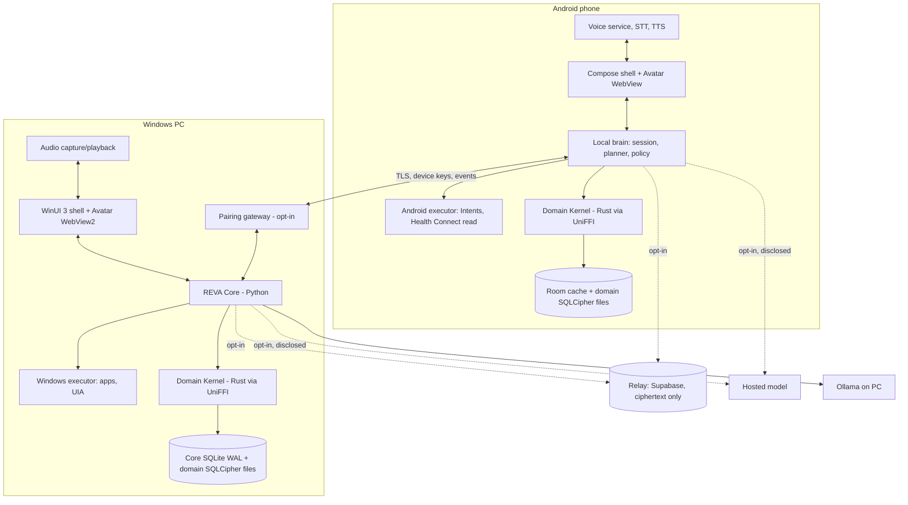

# ARD-000 — REVA System Architecture v2.0

**Document ID:** REVA-ARD-000 · **Version:** 2.0.2 · **Date:** 2026-10-12 · **Status:** Proposed
**Authority:** PRD v2.0 defines behavior; ARDs define boundaries and technical acceptance; ADRs record choices (`03_ADR`).
**Supersedes:** REVA-ARD-001 v1.0 §1–2 (archived).

## 1. One-paragraph architecture

Two full devices, one shared Domain Kernel, one avatar package, one contract folder. The **Windows app** (WinUI 3) owns the window, audio hardware, avatar host and Windows executors; it talks over loopback to the **REVA Core** (Python), which owns sessions, voice, planning, policy and sync, and loads the **Domain Kernel** (Rust) for all life-domain data. The **Android app** (Kotlin/Compose) owns its screens, audio, avatar host and Android executors, and runs an in-process **local brain** with the same policy registry and the same Kernel. Each device is authoritative for its own copy of the data; sync converges the copies over the LAN through the pairing gateway, or optionally through a relay that stores only ciphertext.

## 2. Principles (v1 principles kept, two added)

1. One product, two native clients, one protocol vocabulary.
2. Modular monolith Core; no microservices, brokers or distributed databases.
3. Cognition is separate from authority: a model proposes, policy authorizes, executors prove.
4. Transport separate from semantics.
5. Local-first; both devices fully useful offline.
6. Progressive voice complexity (turn-based first, duplex later).
7. Explicit data and microphone boundaries.
8. Windows is not Android's permanent backend.
9. Proof over code volume.
10. **(new) Write domain logic once.** Domain rules and storage live only in the Kernel; no app re-implements them.
11. **(new) The avatar is a status display, not a decoration.** It shows only true state.

## 3. Containers

## 4. Trust zones

| Zone | Contents | Rule |
|---|---|---|
| Untrusted input | speech transcripts, model output, screen/UIA text, imported files, synced events from peers, relay payloads | Treated as data; validated against schemas; never grants permissions |
| Deterministic authority | policy broker, capability registry, approval binding, Kernel validation | Computes risk tier; signs grants; rejects unknown fields |
| Native effect | Windows executor, Android executor | Acts only on a valid grant; returns observed evidence |

## 5. Module map

| ID | Module | Runs on | ARD |
|---|---|---|---|
| M-01 | WindowsShell + AvatarHost | WinUI 3 | ARD-100 |
| M-02 | WindowsAudio | WinUI 3 | ARD-100 |
| M-03 | AndroidShell + AvatarHost | Compose | ARD-200 |
| M-04 | AndroidAudio | Kotlin service | ARD-200 |
| M-05 | SessionCoordinator | Core; Android local brain | ARD-300 |
| M-06 | SpeechGateway | Core | ARD-400 |
| M-07 | DialogueOrchestrator / Planner | Core; Android local brain | ARD-600 |
| M-08 | PolicyAndTools | Core + executors; Android local brain | ARD-600 |
| M-09 | Memory | Domain Kernel | ARD-700 |
| M-10 | PairedDeviceGateway | Windows (opt-in) | ARD-500 |
| M-11 | SyncCoordinator | Core; Android | ARD-500 |
| M-12 | AuditObservability | each device | ARD-300 / ARD-800 |
| M-13 | RuntimePackaging | build/release | ARD-800 |
| M-14 | ProviderRegistry | Core; Android | ARD-300 |
| M-15 | **DomainKernel** | Core (Python binding); Android (Kotlin binding) | ARD-700 |
| M-16 | **AvatarPackage** | WebView2; Android WebView | ARD-400 |
| M-17 | **WindowsExecutor** | Windows | ARD-100 |
| M-18 | **HealthConnectAdapter** | Android | ARD-200 |
| M-19 | **LanguageLayer** (normalize, rules, resolution, dialogue state, authorize, NLG) | Core; Android local brain | ARD-450 |
| M-20 | **VoiceAssets** (manifest-verified models) | asset root + provider loaders | ARD-400 |

## 6. Cross-cutting requirements

| ID | Stage | Requirement | Verification |
|---|---|---|---|
| AR-SYS-001 | P0 | Existing `reva_core` routes and WinUI behavior preserved while capabilities are added (was AR-001). | Existing suites green |
| AR-SYS-002 | R1 | Import-graph guard: apps never import Kernel internals or open domain files (extends AR-009). | Static dependency test |
| AR-SYS-003 | R1 | Every cross-process message carries `schema_version`, `event_id`, `device_id`, `session_id`/`aggregate_id`, `sequence`, `kind`, `payload` (AR-005). | Schema validation in `08_CONTRACTS` |
| AR-SYS-004 | R1 | Contracts generated from `08_CONTRACTS` for Python, C# and Kotlin; no hand-written divergent types (AR-011). | CI generation diff |
| AR-SYS-005 | R2 | Each device authoritative for its local copy; no device can write another device's store directly. | Gateway API audit |
| AR-SYS-006 | R1 | Correlation IDs flow UI → Core → providers → executor → audit, without audio bytes (NFR-009). | Trace fixture |

## 7. Requirement namespaces

| Prefix | ARD |
|---|---|
| AR-SYS | ARD-000 |
| AR-WIN | ARD-100 |
| AR-AND | ARD-200 |
| AR-CORE | ARD-300 |
| AR-VA | ARD-400 |
| AR-LANG | ARD-450 |
| AR-DATA | ARD-500 |
| AR-AGT | ARD-600 |
| AR-DOM | ARD-700 |
| AR-REL | ARD-800 |

Every v1 `AR-001…AR-082` and `AR-AI-001…AR-AI-036` is mapped to one v2 owner in `07_TRACEABILITY`. A v1 requirement keeps its v1 text unless an ARD row marked "Replaces" changes it.

## 8. No-go criteria (v1 §15 kept, extended)

- No new backend service without a measured need.
- No WebRTC migration without failed WebSocket measurements.
- No Android always-on wake word claim.
- No "end-to-end encrypted" label for the relay before adversarial tests pass.
- No voice readiness claim from mocks.
- No public beta without signed artifacts, revocation, deletion and safe authorization.
- No 2.0.0 without standalone Android, clean Windows install, and all eight domains passing offline on both devices.
- **(new)** No domain logic outside the Kernel. No money-movement capability anywhere. No health diagnosis output.
