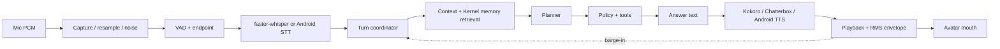

# ARD-400 — Voice and Avatar v2.0

**Document ID:** REVA-ARD-400 · **Version:** 2.0.2 · **Date:** 2026-10-12 · **Status:** Proposed
**Replaces:** ARD v1 §4. **Decisions:** ADR-004 (amended by ADR-025/ADR-040), ADR-005, ADR-018, ADR-024, ADR-037, ADR-038. Language layers: ARD-450.

## 1. Voice pipeline

Turn-based with barge-in first (ADR-005). Chunked TTS by sentence is allowed and labeled as chunked, never as streaming (v1 rule). Audio frames: v1 audio contract kept (`pcm_s16le`, 20 ms frames, `sequence`, `turn_epoch`, `capture_ts_ms`, `is_final`, `stop_reason`).

## 2. Providers

| Slot | First | Second | Android |
|---|---|---|---|
| VAD | Corx VAD and endpointing (~280 ms end-of-speech; pauses become follow-up turns), re-tuned on REVA mic fixtures | energy VAD fallback | platform recognizer endpointing |
| STT | faster-whisper with a words-only vocabulary prompt (Lakewood finding), model size re-benchmarked on wideband mic | consented hosted | `SpeechRecognizer` (on-device when available) |
| TTS | **Revi** (trained voice; engine chosen by bakeoff) once it passes the voice gate; until then Kokoro-82M `af_heart`. All providers use the harvested protocol: speak / stop / health, interrupt, no orphan processes | Kokoro (when Revi is default) | Android `TextToSpeech`, or Revi/Kokoro audio streamed from PC when paired |
| Wake word | Porcupine, default off, hash-bound | — | none (ADR-012) |

## 3. Avatar asset specification

- **Format:** VRM 1.0, exported from Blender with the VRM Add-on for Blender. Source `.blend` and exported `.vrm` in `assets/avatar/` under Git LFS.
- **Rig:** VRM humanoid bones; look-at configured.
- **Expressions:** `aa`, `ih`, `ou`, `ee`, `oh` (mouth); `blinkLeft`, `blinkRight`, `blink`; `happy`, `sad`, `relaxed`, `surprised`, `neutral`.
- **Clips (VRMA):** idle loop, listening loop, thinking loop, talking body loop, approval-wait, error.
- **Budget:** ≤ 50,000 triangles; textures ≤ 2048 px; MToon shading; one draw-call-friendly material set where possible.
- **Character:** original design owned by the user; adult proportions; no third-party characters.
- **Placeholder:** a license-clear sample VRM is used until the Blender model is delivered (slice A1–A4).

## 4. Avatar runtime

- `avatar/` is one web package: three.js + `@pixiv/three-vrm`, bundled locally, exact versions pinned. Same build runs in WebView2 (Windows) and Android WebView.
- Host → page messages only (`postMessage` / `PostWebMessageAsJson`). The page sends back only `avatar.ready` and `avatar.error`.
- Events (schema `08_CONTRACTS/avatar-events.schema.json`):

| Event | Payload | Source |
|---|---|---|
| `avatar.state` | `state` ∈ idle, listening, thinking, speaking, approval, error; `turn_epoch` | Session state machine |
| `avatar.mouth` | `t_ms`, `rms` (0–1) or `viseme`, `turn_epoch` | Playback envelope (v1: RMS at ~60 Hz; v2: Rhubarb-style visemes from the synthesized WAV) |
| `avatar.expression` | `name`, `cause` ∈ verified_outcome, greeting, error, user_emotion_none | Policy outcome / session |
| `avatar.settings` | `enabled`, `reduced_motion`, `quality` | Settings |

- Any event whose `turn_epoch` is older than the current one is dropped.
- `listening` is sent only when the capture adapter reports the mic resource open.
- `expression` with a positive name requires `cause = verified_outcome` from an executor result with status `verified`.

## 5. Requirements

| ID | Stage | Requirement | Verification | Replaces |
|---|---|---|---|---|
| AR-VA-001 | R1 | Audio capture and playback are pluggable native adapters | Mock PCM fixture | AR-014 |
| AR-VA-002 | R1 | Bounded audio buffers; drops never execute partial commands | 20-min noise load | AR-015 |
| AR-VA-003 | R1 | One active audio producer per mic, arbitrated with wake word | Arbitration tests | AR-016 |
| AR-VA-004 | R1 | TTS output carries `turn_epoch`; obsolete frames discarded | Interrupt test | AR-017 |
| AR-VA-005 | R1 | Partial transcripts never trigger actions | False-positive fixture | AR-018 |
| AR-VA-006 | R1 | Low-confidence tool phrase → clarification | Eval set | AR-021 |
| AR-VA-007 | R1 | Pre-recorded clips for CI; physical-mic suite opt-in and never reported as passed when skipped | CI evidence audit | AR-022, AR-AI-015 |
| AR-VA-008 | R1 | Kokoro provider: speak/stop/health, interrupt without overlap, zero orphan processes after kill | Real-process test with PID check | new (harvested) |
| AR-VA-009 | R1 | Avatar state mirrors real session state incl. ApprovalPending | State-projection tests | FR-AV-002 |
| AR-VA-010 | R1 | Lip-sync offset ≤ 100 ms p95 vs played audio | Loopback measurement | FR-AV-003, MET-12 |
| AR-VA-011 | R1 | Positive expressions only with `cause = verified_outcome` | False-success corpus | FR-AV-005 |
| AR-VA-012 | R1 | Avatar off and reduced-motion settings | Settings test | FR-AV-006 |
| AR-VA-013 | R3 | Viseme lip sync replaces RMS | Offset measurement | FR-AV-008 |
| AR-VA-014 | R3 | Network media events authenticated; ordered recovery or clean restart | Packet-loss fixture | AR-026 |
| AR-VA-015 | R3 | Turn-end and barge-in thresholds configurable and measured | p50/p95 report | AR-027 |
| AR-VA-016 | R4 | Per-turn timings recorded: speech end, STT final, first token, TTS first byte, first sample | Observability schema | AR-028 |
| AR-VA-017 | R4 | Noise corpora: silence, overlap, echo, accents, short and long utterances | Labeled eval | AR-029 |
| AR-VA-018 | R1 | Streaming falls back to buffered STT/TTS with declared UX change | Degraded provider test | AR-AI-014 |
| AR-VA-019 | R1 | Voice events carry turn ID, sequence, cancel ID, timings | Order/late fixture | AR-AI-013 |
| AR-VA-020 | R1 | A TTS voice loads only if its files match `assets.manifest.json` SHA-256 and provenance is not TODO/excluded; otherwise the provider refuses and falls back | Tampered/missing/unlisted model tests | ADR-038 |
| AR-VA-021 | R1 | Voice gate before a voice becomes default: first-audio p50 ≤ 700 ms after text ready on PC, interrupt ≤ 300 ms p95, STT round-trip character error ≤ 3% on the eval script, blind owner rating ≥ Kokoro, no orphan processes | Voice gate report | ADR-040 |
| AR-VA-022 | R1 | Per-stage timings recorded from S06 onward (pulled forward from AR-VA-016) | Trace schema test | ADR-037 |
