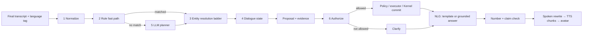

# ARD-450 — Language Understanding and Generation (NLU / NLG) v2.0

**Document ID:** REVA-ARD-450 · **Version:** 2.0.2 · **Date:** 2026-10-12 · **Status:** Proposed
**New in 2.0.2.** **Decisions:** ADR-037 (Lakewood/Corx voice structure), ADR-039 (layered NLU/NLG), ADR-019, ADR-033.
**Pattern source:** Lakewood order agent — rule interpreter + RapidFuzz + explicit dialogue state, propose → authorize → commit, retrieval ladder, learning events. Restaurant logic, telephony, data and keys are not imported.

## 1. Summary

REVA understands speech in layers that get more expensive only when needed, and it speaks in layers that get more free-form only when it is safe. Known commands never touch a model. Every action or domain write is a **proposal with evidence** that a deterministic authorizer accepts or turns into a clarifying question. Every spoken outcome comes from a template bound to executor evidence; the model writes only open answers, and any number it says must exist in the tool results.

## 2. Turn pipeline

Partial transcripts never enter this pipeline (AR-VA-005). The pipeline runs identically in the Windows Core and the Android local brain; rule grammars, alias tables and templates are shared artifacts in `contracts/language/`.

## 3. NLU components

### 3.1 Normalize (deterministic)
- Spoken numbers, money, percentages: "twelve bucks" → `{amount: 12.00, currency: USD}`; "two fifty" ambiguity → keep both readings and let resolution ask.
- Dates, times, durations relative to the device clock and time zone: "tomorrow at 7" → ISO datetime; "for forty minutes" → `PT40M`.
- Filler and STT noise removed from matching but kept in the transcript for audit ("can I please", "uh", "like").
- **Code-mixed Telugu–English:** language tag per token span from the STT result or a lightweight detector; numbers and dates parsed in both; app and category names matched in both scripts and romanized forms via the alias table.
- Output: an `NluFrame` (`08_CONTRACTS/nlu-frame.schema.json`).

### 3.2 Rule fast path (deterministic)
- Grammar rules (regex + spaCy Matcher on English; alias/regex tables for Telugu forms) for high-frequency intents: `app.open`, `app.close`, `finance.add_transaction`, `health.log_workout`, `health.log_meal`, `personal.reminder.create`, `memory.remember`, `memory.recall`, `today.get`, `learn.quiz`, `assistant.stop`, `assistant.repeat`, `assistant.undo_last`.
- A rule match produces intent + raw slot phrases; it never commits anything by itself.
- Rule set is versioned; every rule has positive and negative fixtures.

### 3.3 Entity resolution ladder (Lakewood)
`exact canonical → verified alias → lexical/token → fuzzy (RapidFuzz) → vector (embedding) → ask`.

| Evidence | Default action |
|---|---|
| Exact canonical or verified alias | resolve |
| Previously confirmed clarification for this phrase | resolve |
| Fuzzy or vector, single candidate, score ≥ threshold **and** margin ≥ threshold over runner-up | ask in R1–R2 (shadow-log scores); may auto-resolve only after calibration (§6) |
| Multiple close candidates | ask with top 2–3 |
| Below floor | say it isn't known; offer to add an alias |

Vector similarity runs in **shadow mode** first: it logs phrase, candidates, top-1/top-2 scores, margin and the user's final choice, but does not decide.

Resolved entity types: installed/allowlisted apps, finance accounts and categories, people (Personal), habits and goals (Coach), decks and courses (Learn), memory items.

### 3.4 Dialogue state tracker
Per session: active intent, filled and missing slots, `pending_clarification` (question id, options, expires at), `last_referenced` entities (for "that one", "delete it", "change it to 15"), last committed action id (for undo), language preference, and `turn_epoch`. Persisted after every accepted proposal so a crash or app restart resumes cleanly. Barge-in increments `turn_epoch` and cancels any pending clarification that was being spoken.

### 3.5 LLM planner (fallback, bounded)
Only when no rule matches or a slot needs open interpretation. Input: normalized transcript, dialogue state, minimal Kernel query results, live capability list, consented-domain filter. Output: `PlannerDecision` (strict schema). The planner may propose; it never resolves entities by itself (its entity text goes through §3.3) and never authorizes.

### 3.6 Authorize (deterministic, shared)
`authorize(proposal, state) -> AuthorizationDecision` (`08_CONTRACTS/authorization-decision.schema.json`). Pure function: no model calls, no writes, stable reason codes, fully logged.

Checks, in order: capability exists in registry · arguments valid against `args_schema` · every entity has evidence of an allowed resolution type · no unresolved content-bearing words remain (filler excluded) · no competing candidate within margin · proposal fits current dialogue state · domain consent and device scope · tier requirements (T2 approval, T3 deny).

Reason codes: `OK`, `UNKNOWN_CAPABILITY`, `INVALID_ARGS`, `UNRESOLVED_TERMS`, `AMBIGUOUS_ENTITY`, `LOW_EVIDENCE`, `STATE_MISMATCH`, `CONSENT_REQUIRED`, `APPROVAL_REQUIRED`, `DENIED_TIER`, `FORBIDDEN_CAPABILITY`.

## 4. NLG components

### 4.1 Templates (deterministic, evidence-bound)
All confirmations, outcomes, clarifications, refusals, errors and acknowledgements are templates keyed by `(intent, outcome_status, reason_code, language)`. Examples:
- Proposal confirm: "Add {amount} for {category}, {date_spoken}?"
- Verified outcome: "Saved. {amount} on {category}." — only when the Kernel returned a committed event id.
- Unknown outcome: "I couldn't confirm that it worked. Check Activity."
- Clarify ambiguous: "Did you mean {opt1} or {opt2}?"
- Forbidden: "I can't move money. I can record it or show your spending."

### 4.2 Acknowledge-first (Corx turn-taking)
If reasoning will exceed ~700 ms, REVA plays a short neutral acknowledgement ("One sec.", "Checking.") from a template while the avatar shows the thinking pose. Acknowledgements are never phrased as success, are skipped for fast-path turns, and are cancelled by barge-in.

### 4.3 Grounded answers (LLM)
For open questions and summaries. The model receives tool and Kernel results with source ids and must cite them; it may not state facts about the user's data that are absent from those results ("I don't have that" is the required fallback, harvested from Memory Engine abstention).

### 4.4 Number and claim check
Before speaking a model answer: every number, date and amount in the text must match a value in the tool results (after normalization); any claim of an action ("I added", "I opened") must match an executor or Kernel outcome in this turn. On failure: regenerate once with the violation stated; on second failure, fall back to a template summary of the raw results.

### 4.5 Spoken rewrite and chunking
Short sentences; numbers and currency spoken naturally per language; lists of more than three items summarized with "and N more"; text split at sentence boundaries into TTS chunks carrying `turn_epoch`; optional prosody hints (pause, emphasis) passed to providers that support them. The avatar mouth follows the played audio, not the text.

### 4.6 Persona
One consistent REVA voice and style: warm, brief, direct; never claims feelings about outcomes it cannot verify; same persona in English and Telugu templates. Persona text lives in versioned prompt and template artifacts (AR-AGT-022).

## 5. Languages

| Language | Stage | Scope |
|---|---|---|
| English | R1 | full NLU/NLG, all templates |
| Telugu and Telugu–English code-mixed | R3 (owner may pull forward) | normalization, rule aliases, templates, TTS voice that passes the Telugu eval |

Language selection follows FR-017: explicit active language, fallback stated, no fake confidence on mismatch.

## 6. Evaluation and learning loop (Lakewood Phase 5)

- **TurnEvent** recorded per turn (local, redacted): transcript, language, rule hit, candidates + scores, proposal, AuthorizationDecision, user confirmation or correction, final outcome, model/rule/template versions.
- Label priority: explicit user correction > confirmed clarification > final committed record > reviewed transcript > model output (never ground truth).
- Every failed or corrected turn becomes a permanent fixture in `tests/language-evals/`.
- Alias table grows from confirmed clarifications (reviewed, versioned). A reranker or auto-resolution threshold is enabled only after ≥ 200 labeled mentions per entity type and a precision ≥ 99.5% on held-out data.
- No automatic retraining or rule changes in production.

| Metric | R1 target | 2.0.0 target |
|---|---|---|
| Wrong auto-resolution (silent wrong entity) | 0 | 0 |
| Intent accuracy on fast-path eval set | ≥ 97% | ≥ 98% |
| Slot accuracy for money/date/duration | ≥ 98% | ≥ 99% |
| Model answers failing number check after one retry | ≤ 2% | ≤ 1% (all fall back to template) |
| False "done" | 0 | 0 |
| Fast-path NLU latency p95 | ≤ 50 ms | ≤ 30 ms |

## 7. Requirements

| ID | Stage | Requirement | Verification | Replaces |
|---|---|---|---|---|
| AR-LANG-001 | R1 | Only final transcripts enter NLU; partials are display-only | Partial-injection test | AR-018 |
| AR-LANG-002 | R1 | Normalizer converts money, numbers, dates, times, durations to typed values with ambiguity preserved | Normalization fixtures (en) | new |
| AR-LANG-003 | R1 | Rule fast path for the listed intents; each rule has positive and negative fixtures; no commit from rules alone | Rule fixture suite | AR-AI-008 |
| AR-LANG-004 | R1 | Entity resolution ladder with stable thresholds; vector results shadow-only until calibrated | Ladder tests + shadow log | new |
| AR-LANG-005 | R1 | Dialogue state persisted after each accepted proposal; reference resolution for "that/it/the last one" | Restart-resume + anaphora fixtures | new |
| AR-LANG-006 | R1 | Planner entity text always passes the resolution ladder; planner cannot resolve or authorize | Planner bypass test | AR-AI-002 |
| AR-LANG-007 | R1 | `authorize()` is pure, deterministic, model-free, write-free, with stable reason codes, shared by rule and planner paths | Property tests; static check for no I/O | AR-031, AR-035 |
| AR-LANG-008 | R1 | Unresolved content-bearing words block commit; filler does not | Filler vs content fixtures | new |
| AR-LANG-009 | R1 | All confirmations, outcomes, errors, refusals and acks are templates bound to outcome status | Template coverage test per intent × status | FR-AI-007 |
| AR-LANG-010 | R1 | Acknowledge-first only when reasoning > 700 ms; never phrased as success; cancelled on barge-in | Timing + wording tests | new |
| AR-LANG-011 | R1 | Grounded answers cite sources and abstain when data is missing | Abstention eval | FR-MEM-002 |
| AR-LANG-012 | R1 | Number and claim check on every model answer; one retry then template fallback | Injected-hallucination fixtures | FR-DOM-005 |
| AR-LANG-013 | R1 | Spoken rewrite and sentence chunking carry `turn_epoch` | Chunk/epoch tests | AR-VA-004 |
| AR-LANG-014 | R1 | TurnEvent recorded locally with redaction; failed turns exported as fixtures | Event schema + export test | AR-AI-035 |
| AR-LANG-015 | R2 | Same rules, aliases, templates and authorizer run on Android (shared artifacts) | Cross-platform parity suite | ADR-030 |
| AR-LANG-016 | R3 | Telugu and code-mixed normalization, aliases and templates | Telugu fixture suite | FR-017 |
| AR-LANG-017 | R3 | Auto-resolution enabled per entity type only after calibration gate (≥ 200 labels, precision ≥ 99.5%) | Calibration report | new |
| AR-LANG-018 | R1 | Forbidden capabilities (money movement, dosing) produce the refusal template, never a proposal | Forbidden-intent fixtures | ADR-033 |
