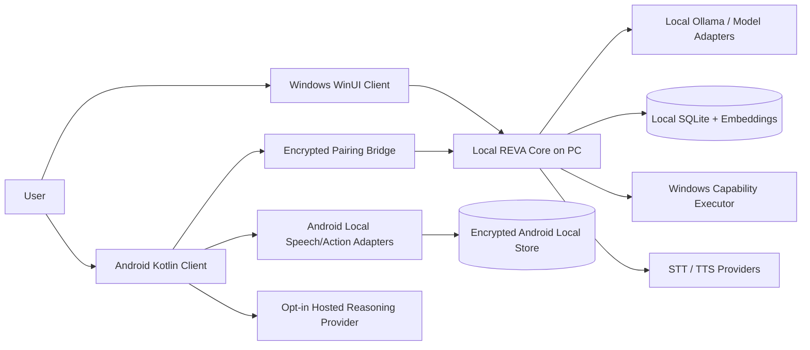
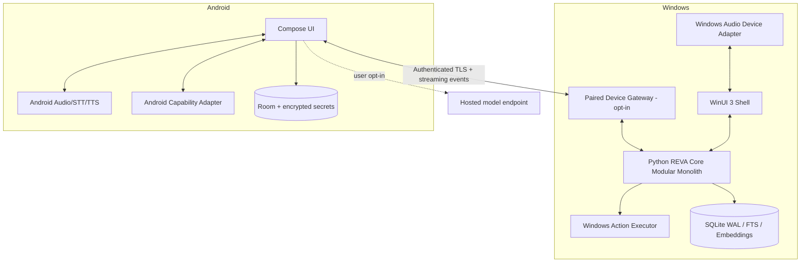
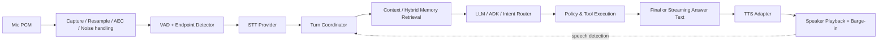
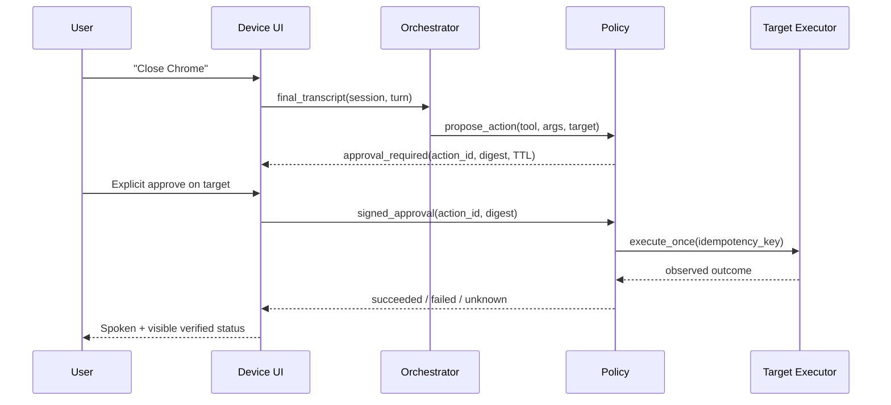

# REVA — Architecture Requirements Document (ARD)

**Document ID:** REVA-ARD-001 | **Version:** 1.0 proposed | **Date:** 2026-10-11  
**Scope:** Windows + Android full voice assistant; staged through R4 full V1.  
**Authority:** PRD defines user behavior; this ARD defines system boundaries and technical acceptance. ADRs record choice rationale.  
**Existing code baseline:** `D:\Projects\Reva` is a Windows WinUI 3 and Python FastAPI repository, *not* yet a cross-platform app.

## 1. Architectural principles and complexity budget

1. **One product, two native clients, one protocol vocabulary.** Android-specific capture and actions cannot be implemented by Windows code.
2. **Modular monolith Core first.** The Python process owns dialogue, policy, memory and local voice coordination; no Kubernetes, RabbitMQ, Kafka, distributed vector database or multi-service fleet in R1/R2.
3. **Separation of cognition and authority.** A model may suggest structured actions, but cannot itself authorize, execute or claim success.
4. **Transport separate from semantics.** The same typed voice/session events can pass across internal Python queues, local HTTP/WebSocket and future WebRTC bridge.
5. **Local-first.** No hosted services required for Windows local-mode if models are installed; Android offline has a clearly declared smaller capability set.
6. **Progressive voice complexity.** Start with a working STT → LLM → TTS voice loop; add partial transcripts, incremental synthesis and barge-in; use WebRTC/LiveKit only when measured network conditions require it.
7. **Explicit data and microphone boundaries.** Raw audio transient by default; saved memory governed by user action, not automatic inference.
8. **Windows is not Android's permanent backend.** A paired PC accelerates early APK, but R3 requires a phone-independent reasoning path.
9. **Proof over code volume.** Every subsystem has an owner, integration fixture and failure case.

### C4-level context



The bridge is logically separate from the loopback API: remote devices **never receive the Windows Core local bearer credential**, and the default Core bind remains loopback only.

### C4-level container/runtime



**Gateway placement decision:** expose a separate, narrow paired-device entry point while Core remains `127.0.0.1`. If a gateway is in-process or sidecar, its public surface MUST be an allowlisted subset with independent authentication and quotas. A workstation firewall or loopback proxy is not a substitute for an authorization check.

## 2. Subsystems and ownership

| Module ID | Module | Runs on | Responsibilities | Explicitly not responsible for |
|---|---|---|---|---|
| M-01 | WindowsShell | Windows .NET/WinUI | mic UI, status, dialogs, speaker output, accessibility | model policy |
| M-02 | WindowsAudio | Windows native adapter | exclusive capture, resample, AEC where available, device loss | user-memory writes |
| M-03 | AndroidShell | Kotlin/Compose | screen flows, session controls, permissions, status | direct PC executable control |
| M-04 | AndroidAudio | Kotlin service/adapters | speech recognizer, AudioRecord as needed, TTS, lifecycle | unrestricted hotword |
| M-05 | SessionCoordinator | Python Core + Android local sessions | turn IDs, state machine, cancellation, deadlines | deciding authorization |
| M-06 | SpeechGateway | Python Core / provider interface | STT, VAD, endpointing, TTS streaming/chunking | arbitrary OS commands |
| M-07 | DialogueOrchestrator | Python Core | LLM/ADK calls, dialogue context, structured intents | executing tool side-effects |
| M-08 | PolicyAndTools | Core + target client | schema validate, authorization, confirm, execute, evidence | trusting tool claims from model |
| M-09 | MemoryService | Python Core; Android cache | explicit CRUD, hybrid retrieval, retention, sync events | ambient recording |
| M-10 | PairedDeviceGateway | Windows opt-in boundary | enrollment, device auth, event transport, scope/rate limits | local full-scope Core API exposure |
| M-11 | SyncCoordinator | pair peers | outbox, conflict resolution, revocation/tombstones | auto-merging deleted secrets |
| M-12 | AuditObservability | each device | structured events, correlation, redaction, opt-in metrics | shipping raw audio by default |
| M-13 | RuntimePackaging | build/release | installer, APK/AAB, upgrades, rollback, artifacts | product logic |
| M-14 | ProviderRegistry | Core + Android | capabilities, provider availability, configured processing region/path | unlimited automatic provider switching |

## 3. Architecture requirements: Core and contracts

| ID | Stage | Requirement | Verification |
|---|---|---|---|
| AR-001 | P0 | Preserve existing `reva_core` FastAPI routes and WinUI behavior while adding versioned capabilities. | Current suites remain green. |
| AR-002 | R1 | Keep a single process modular Core and internal dependency boundaries. | Import graph / architecture test. |
| AR-003 | R1 | Central `SessionCoordinator` owns exactly one active voice turn per session. | Concurrency tests. |
| AR-004 | R1 | Session IDs, turn IDs and correlation IDs propagate through STT/LLM/TTS/tool events. | Trace fixture assertions. |
| AR-005 | R1 | Typed event schema includes `schema_version`, `event_id`, `sequence`, `timestamp`, `device_id`, `session_id`, `turn_id`, `kind` and `payload`. | JSON schema validation. |
| AR-006 | R1 | Protocol evolution is additive within a major version; unknown required major is rejected. | Compatibility tests. |
| AR-007 | R1 | Cancellation token/epoch invalidates all older pending provider responses. | Late-response injection test. |
| AR-008 | R1 | Provider deadlines exist separately for VAD/STT, model, tool and TTS. | Timeout fixture. |
| AR-009 | R1 | No client takes a database file handle outside its owning device process. | Static dependency guard. |
| AR-010 | R2 | Windows Core API remains loopback and bearer-auth protected; remote access only through paired gateway. | Port scan + auth tests. |
| AR-011 | R2 | Android contracts generated/shared from versioned JSON Schema/OpenAPI; no handwritten divergent event types. | Contract generation in CI. |
| AR-012 | R3 | Configuration resolution is explicit per user/device/provider with encrypted secrets. | Config precedence tests. |
| AR-013 | R4 | Graceful upgrade migrates schemas without losing data; rollback compatibility declared. | Snapshot migration tests. |

## 4. Real-time voice system (Lakewood-style reusable pattern)

### Voice pipeline



**Choice:** use existing faster-whisper and Chatterbox provider integrations as first adapters. A “streaming” user experience can initially synthesize short text chunks while recording precise latency, then introduce genuinely streaming models if proven necessary. Do not label a batch model as streaming.

### State machine

`Idle → AcquiringPermission → Listening → Endpointing → Transcribing → Reasoning → [ApprovalPending → Executing] → Speaking → Listening/Idle`. Any state can transition through `Cancelling` to `Idle`; errors return `RecoverableError` or `FatalError` with cleanup. A new valid user interruption increments `turn_epoch`, atomically stops playback, and marks old generated audio invalid.

### Audio/stream contract v1 (proposed)

| Field | Description |
|---|---|
| `codec` | `pcm_s16le` initially; Opus may be negotiated later |
| `sample_rate_hz` | negotiated; adapters resample to provider input |
| `channels` | mono for STT baseline |
| `frame_duration_ms` | 20 ms nominal; adaptive buffering allowed |
| `sequence` | monotonically increasing per media stream |
| `turn_epoch` | integer invalidating stale media |
| `capture_ts_ms` | monotonic device timestamp (not wall-clock sync assumption) |
| `is_final` | STT finals immutable; partials replaceable |
| `stop_reason` | `USER_STOP`, `BARGE_IN`, `TIMEOUT`, `DEVICE_LOST`, `ERROR` |

### Voice architecture requirements

| ID | Stage | Requirement | Verification |
|---|---|---|---|
| AR-014 | R1 | Audio capture and TTS playback are pluggable native adapters. | Mock PCM fixture. |
| AR-015 | R1 | Bounded audio input/output buffers prevent OOM; drop strategy never silently executes partial commands. | 20-min noise load test. |
| AR-016 | R1 | Voice session has one active audio producer per selected microphone, arbitrated with wake word. | resource arbitration tests. |
| AR-017 | R1 | TTS output carries the originating `turn_epoch`; on interrupt obsolete frames are discarded. | interrupt test. |
| AR-018 | R1 | Partial transcript must not trigger sensitive actions; only stabilized final user intent enters policy. | false-positive fixture. |
| AR-019 | R1 | Provider-specific STT/TTS types remain behind protocol interfaces; selection driven by capability. | fake/real adapters pass contract tests. |
| AR-020 | R1 | Stale provider response cannot rewrite current composer, history or spoken output. | race injection tests. |
| AR-021 | R1 | Low-confidence tool phrase results in clarification, not speculative execution. | eval set. |
| AR-022 | R1 | Pre-recorded clips are used for deterministic transcript/turn regression; physical-mic suite opt-in. | CI+hardware evidence. |
| AR-023 | R1 | Microphone activation indicator derived from actual resource state, not only UI requested state. | permissions/device-loss tests. |
| AR-024 | R2 | Android checks on-device STT availability and discloses use of fallback recognizer. | API-level capability tests. |
| AR-025 | R2 | Android stops mic promptly when activity/foreground-service lifecycle disallows access. | lifecycle tests on devices. |
| AR-026 | R3 | Network media events are authenticated and have ordered stream recovery or clean session restart. | packet-loss/reconnect fixture. |
| AR-027 | R3 | Turn-end and barge-in thresholds configurable and measured by device/provider. | p50/p95 trace report. |
| AR-028 | R4 | Record per-turn timings: user speech end, STT final, LLM first token, TTS first byte, playback first sample. | observability schema test. |
| AR-029 | R4 | Background/noise test corpora include silence, overlap, echo, accents, short commands, long utterances. | labeled eval report. |

## 5. Intent policy, execution and device security

### Tool execution protocol



**Policy matrix:**

| Tier | Example | Allowed UX | Target confirmation |
|---|---|---|---|
| T0 Informational | answer, memory query | after user request | none |
| T1 Safe reversible | open Calculator, navigate within app | authorized + allowlisted | optional user gesture |
| T2 Sensitive | close app, write memory, create reminder, share files | explicit per-action consent | target-device confirmation for remote |
| T3 High-risk | shell, delete files, send email, payment, install software, change security settings | deny by default; future specialized review | never model-only |

### Action proposal schema example

```json
{
  "schema_version": "1.0",
  "action_id": "uuid",
  "session_id": "uuid",
  "turn_id": "uuid",
  "source_device_id": "device-opaque",
  "target_device_id": "device-opaque",
  "capability": "windows.app.open",
  "arguments": {"app_key": "calculator"},
  "risk_tier": "T1",
  "idempotency_key": "uuid",
  "deadline_ms": 10000
}
```

The executor never trusts `risk_tier` from a model or network request: policy computes tier from the server-side capability registry and validated arguments. IDs above are examples, not live credentials.

### Tool/policy architecture requirements

| ID | Stage | Requirement | Verification |
|---|---|---|---|
| AR-030 | R1 | Model can request only registered capabilities; tool calls are not raw shell commands. | injection tests. |
| AR-031 | R1 | Action proposal is schema-validated and normalized before policy check. | property fuzz tests. |
| AR-032 | R1 | Risk tier calculated independently of model-provided hints. | tamper tests. |
| AR-033 | R1 | Approval binds action ID, canonical arguments, target ID, scope and TTL. | replay/substitution tests. |
| AR-034 | R1 | Executor records success with actual OS/provider evidence, failure and unknown outcomes. | mock+physical tests. |
| AR-035 | R1 | Unsafe action is denied when confirmation absent, stale, ambiguous or sourced only from speech for sensitive tier. | negative suites. |
| AR-036 | R2 | Paired phone never obtains PC OS process handles or a generic remote-execute API. | gateway API audit. |
| AR-037 | R2 | Remote operations are authorized against sender identity AND target policy. | cross-device substitution tests. |
| AR-038 | R2 | Android actions use sanctioned platform APIs and respect runtime grants. | device permissions tests. |
| AR-039 | R3 | Multi-step plans carry max steps, max runtime, total tool budget and cancel propagation. | runaway loop tests. |
| AR-040 | R4 | Action ledger has immutable outcome record and redacted arguments with user-facing inspection. | reconciliation test. |

## 6. Identity, pairing and remote transport

**Local Windows identity:** OS user context and protected local Core auth material; replace plaintext local token with DPAPI/Credential Manager before distribution.  
**Android local identity:** app installation generates keypair in Android Keystore and keeps user tokens private.  
**Pairing:** user triggers on PC; PC shows short-lived QR with one-time pairing session and pinned gateway public key hash; phone scans, opens TLS endpoint, displays matching code; PC user approves; each device records a bounded device identity/capability grant. Mutual authentication via possession of device key (signed challenge). Insecure LAN access or unauthenticated mDNS is never sufficient to pair.  
**Revocation:** PC can revoke any linked device, effective before next action. Android can forget PC. Rotate credentials on a suspected compromise.  
**Remote routing:** R2 LAN only. R3/R4 optional off-LAN relay is separate ADR and privacy review, not presumed by using LiveKit.

| ID | Stage | Requirement | Verification |
|---|---|---|---|
| AR-041 | R2 | Pairing key agreement authenticated by explicit user-approved QR/fingerprint. | MITM/wrong-peer test. |
| AR-042 | R2 | Gateway TLS and device auth required for any paired connection. | unauthenticated access test. |
| AR-043 | R2 | Paired keys scoped to only approved actions/data classes. | privilege escalation tests. |
| AR-044 | R2 | Pairing grants revocable with atomic check before dispatch. | stale token and replay test. |
| AR-045 | R2 | Gateway binds to LAN only when user enables remote access and reports interface/port. | interface enumeration/port scan. |
| AR-046 | R2 | No remote caller can invoke Core unrestricted `/v1/*` API. | allowlist contract test. |
| AR-047 | R3 | Stream reconnect requires authenticated resume token and deduplicates prior events. | packet-loss test. |
| AR-048 | R3 | Credentials rotate and support device-key compromise recovery. | key rotation/revoke test. |
| AR-049 | R4 | Security logs record which device made each data/tool request, without raw secrets. | audit format test. |

## 7. Memory, storage, events and sync consistency

### Logical storage model

```text
Conversation(id, title, created_at, updated_at, device_origin, sync_scope)
Message(id, conversation_id, role, content, source_kind, created_at, status)
Memory(id, type, content, source, consent_type, retention_state, version, created_at, updated_at)
Embedding(memory_id, provider, model_version, embedding_vector, updated_at)
Device(id, display_name, public_key_ref, scopes, state, paired_at, revoked_at)
Action(id, capability, device_id, idempotency_key, approval_id, status, evidence_ref)
Event(id, aggregate_type, aggregate_id, version, origin_device_id, kind, payload, created_at)
Outbox(event_id, destination_device_id, attempt_count, last_attempt_at, delivered_at)
SyncCursor(device_id, peer_device_id, stream_id, last_ack_sequence)
```

The schema above is **target conceptual design**, not a claim that these tables exist. Existing Core uses SQLite WAL with memories, messages, audit and embeddings; migration must be additive with isolated backup fixtures.

### Consistency semantics

- **Conversation messages:** immutable append, stable UUIDs, deterministic merge order per source+server acknowledgment; local UI may show eventual update.
- **Memory create/edit:** optimistic version precondition; edits create a new version/event rather than blind overwrite.
- **Memory delete:** tombstone with monotonic version/retention marker; no older off-line edit can resurrect; physical purge after sync retention policy and confirmation.
- **Reminders:** owner-device scheduler, idempotent reminder fire ID; no double notifications after reconnect.
- **Actions:** never replicated as executable commands through generic event replay. Only explicitly authorized action requests go through PolicyAndTools; outcomes sync as informational records.
- **Audio:** never synced by default. Embedded vectors can be rebuilt rather than synced unless encrypted and provider-compatible.

| ID | Stage | Requirement | Verification |
|---|---|---|---|
| AR-050 | R1 | Core memory repository supports explicit create/query/update/archive/delete/export. | API+SQLite tests. |
| AR-051 | R1 | Deletion removes retrieval eligibility, removes/invalidate embeddings and records redacted audit. | semantic+lexical deletion regression. |
| AR-052 | R1 | Hybrid retrieval falls back to lexical on embedding/Ollama failures. | outage tests. |
| AR-053 | R1 | Local user files and voice temporary buffers have bounded lifecycle. | cleanup tests. |
| AR-054 | R2 | Android caches only scoped, needed records; keys live in Keystore. | backup/log inspection. |
| AR-055 | R2 | Schema migrations are transactional, versioned and testable with copied DB. | upgrade/rollback test. |
| AR-056 | R3 | Sync applies per-record idempotent events and durable outbox acknowledgment. | replay/reordering tests. |
| AR-057 | R3 | Conflict policy avoids wall-clock-only last-write-wins for deletes. | skew/offline tests. |
| AR-058 | R3 | Data-scope settings apply to sync send and receive sides. | scope tests. |
| AR-059 | R4 | Export includes human-readable memory/conversation data and documented omissions. | round-trip portability test. |
| AR-060 | R4 | Wipe and unpair revoke credentials and clear queue/embeddings/local caches. | inspection test. |

## 8. Android platform requirements

**Implementation decision:** Android native Kotlin + Jetpack Compose + ViewModel/StateFlow, coroutines, Room for cache, Android Keystore for credentials, platform `SpeechRecognizer` (on-device only when supported), Android TextToSpeech, AudioRecord for advanced streaming when needed. Foreground service with appropriate type for active mic sessions and notification controls; honor while-in-use and background restrictions.

**Do not implement a continuous-recognition loop with generic SpeechRecognizer:** Android API warns its recognizer is not meant for continuous recognition, and standard recognition may send audio to remote servers. No requirement assumes uninterruptible always-on listening or unrestricted device control.

**APK vs AAB:** Build debug/internal signed APKs for testers. New Play listings generally publish an Android App Bundle (AAB); signing keys, Play policy and testing tracks are release responsibilities.

| ID | Stage | Requirement | Verification |
|---|---|---|---|
| AR-061 | R2 | Android minSdk and targetSdk determined by device support + current Play requirements, recorded in build. | Gradle configuration assertion. |
| AR-062 | R2 | Runtime microphone permission requested only on explicit user gesture. | permissions UI tests. |
| AR-063 | R2 | Foreground service type/notification and background-start restrictions honored by API level. | Android 12–16 matrix on available devices/emulators. |
| AR-064 | R2 | Use on-device recognizer only when availability check passes; otherwise disclose fallback. | mock capability test. |
| AR-065 | R2 | Recognizer and TTS lifecycle destroyed/shut down on completion. | leak test. |
| AR-066 | R2 | No `QUERY_ALL_PACKAGES`, Accessibility automation or privileged settings as a shortcut. | manifest review. |
| AR-067 | R2 | Local app functions survive permanent denial of microphone permission. | user-flow test. |
| AR-068 | R3 | Phone can select independent model provider instead of paired PC. | no-PC E2E. |
| AR-069 | R3 | Standalone AI mode communicates data-processing route and network requirements. | settings inspection test. |
| AR-070 | R4 | Signed release APK/AAB validated for installation, upgrade and rollback behavior. | clean-device release checklist. |

## 9. Performance, reliability, privacy and packaging

| ID | Stage | Requirement | Verification |
|---|---|---|---|
| AR-071 | R1 | UI/main threads remain responsive under slow STT/LLM/TTS. | scripted input while processing. |
| AR-072 | R1 | Python Core process lifecycle distinguishes owned vs external. | unit + real PID exit proof. |
| AR-073 | R1 | No raw microphone byte payloads in normal logs. | log scan. |
| AR-074 | R2 | Connection and model capability changes cause explicit UI statuses. | network toggle tests. |
| AR-075 | R2 | Every queue has documented upper bound and handling on saturation. | memory/load tests. |
| AR-076 | R3 | End-to-end voice trace latency budgets recorded per device/provider. | perf benchmark artifact. |
| AR-077 | R3 | Battery and heat budget measured for active and background-allowed voice mode. | 30-min phone profiling. |
| AR-078 | R4 | Windows packaging includes Core interpreter/runtime and model-install guidance. | clean-machine smoke. |
| AR-079 | R4 | Release build signs artifacts and generates SBOM/checksums. | CI release validation. |
| AR-080 | R4 | Security signoff covers Android MASVS, transport, policy, secrets and privacy. | signed QA checklist. |
| AR-081 | R4 | Reliability tests exercise disconnect, service kill, permission loss, device sleep and stale actions. | failure-injection report. |
| AR-082 | R4 | Structured telemetry is opt-in, scoped and redacted, and can be removed by user. | opt-out tests. |

## 10. Proposed API versioning and routes

**Do not replace all existing routes at once.** Existing `/v1/messages`, `/v1/memories`, `/v1/voice/transcriptions`, `/v1/voice/speech`, `/v1/audit-events`, health/version stay for compatibility. Add behind flags and feature contracts:

| Proposed endpoint | Method / transport | Purpose | Trust boundary |
|---|---|---|---|
| `/v1/voice/sessions` | POST | open voice session with provider/mode capabilities | loopback trusted client; gateway mapped |
| `/v1/voice/sessions/{id}` | DELETE | cancel session and release resources | session owner |
| `/v1/voice/sessions/{id}/events` | WebSocket | transcripts, turn state, text/audio metadata, tool proposals | authenticated client |
| `/v1/actions/proposals` | POST | prepare policy-reviewed action | loopback or narrowly scoped gateway |
| `/v1/actions/{id}/approval` | POST | submit signed target-device approval | target identity |
| `/v1/actions/{id}` | GET | inspect action outcome; not trigger execution | scoped read |
| `/v1/memories/{id}` | PATCH/DELETE | edit/archive/delete explicit memory | local user / granted scoped peer |
| `/v1/memories/export` | GET | user data export | high-sensitivity scope |
| `/v1/devices/pair` | POST | exchange pairing proofs after user authorization | gateway only |
| `/v1/devices/{id}/revoke` | POST | revoke paired device | owner on PC |
| `/v1/sync/events` | POST | bounded sync batch with idempotency | paired scoped identity |
| `/v1/sync/cursor` | GET | acknowledged batch position | paired scoped identity |

**Protocol constraints:** request sizes capped; audio payloads use an explicitly negotiated binary frame structure, not giant base64 JSON; session end releases mic/network resources; preserve HTTP status codes and typed machine-readable error bodies. Cross-device gateway must implement its own API shape and translate to Core services rather than transparently forwarding internal REST endpoints.

### Example session event

```json
{
  "schema_version": "1.0",
  "event_id": "example-event-id",
  "session_id": "example-session-id",
  "turn_id": "example-turn-id",
  "device_id": "example-device-id",
  "sequence": 12,
  "kind": "speech.transcript.final",
  "timestamp": "2026-10-11T22:00:00Z",
  "payload": {"text": "Open calculator", "language": "en-US", "confidence": null}
}
```

The timestamp and IDs are sample schema values only. Confidence is nullable because provider calibration varies.

### Error taxonomy

- `VOICE.PERMISSION_DENIED`, `VOICE.DEVICE_LOST`, `VOICE.STT_UNAVAILABLE`, `VOICE.TTS_UNAVAILABLE`
- `MODEL.UNAVAILABLE`, `MODEL.TIMEOUT`, `MODEL.RATE_LIMITED`, `MODEL.CANCELLED`
- `ACTION.UNSUPPORTED`, `ACTION.DENIED`, `ACTION.APPROVAL_REQUIRED`, `ACTION.EXPIRED`, `ACTION.OUTCOME_UNKNOWN`
- `PAIR.UNAUTHORIZED`, `PAIR.REVOKED`, `PAIR.CERT_MISMATCH`, `PAIR.SCOPE_DENIED`
- `SYNC.CONFLICT`, `SYNC.STALE_VERSION`, `SYNC.REPLAY`, `MEMORY.DELETED`

## 11. Target repository layout (proposal, not current tree)

```text
Reva/
  reva_core/
    api/                 # preserve existing APIs and add session endpoints
    assistant/           # provider-independent orchestration
    voice/               # STT/TTS/VAD adapters, session engine
    policy/              # canonical capability policy; model cannot bypass
    tools/               # bounded executors and result evidence
    memory/              # explicit CRUD, retrieval, embedding
    sync/                # event outbox, tombstones, conflict rules
    devices/             # pairing grant and identity service
    observability/       # redacted events and local metrics
    storage/             # SQLite schema and repositories
  desktop/
    src/Reva.Desktop/    # existing WinUI shell and Windows adapters
  android/
    app/src/main/        # NEW Android Compose app
    core-contracts/      # generated protocol schema bindings
  contracts/
    json-schema/
    openapi/
    examples/
  tests/
    unit/ security/ integration/ contract/ voice-evals/ e2e/
  docs/
    prd/ ard/ decisions/ rollout/
  packaging/
    windows/ android/
```

**Migration warning:** Existing Core `tools/` and `policy/` directories are README placeholders, while current desktop commands live in C#. Migrate gradually using a compatibility adapter; do not delete tested Windows executor or pretend the new Core policy implementation already exists.

## 12. Dependencies and build strategy

- **Windows:** WinUI 3/.NET 10 as current audit baseline. Bundle runtime and Python in a later packaging slice; do not assume installed `.venv` on end-user PC.
- **Core:** existing Python project/virtual environment, SQL migrations, Google ADK optional, Ollama optional. Use provider protocols; version-pin dependencies and licensing checks.
- **Android:** Gradle version catalog, Kotlin, Compose, Coroutines, Room, encrypted key material via Keystore. Min/target SDK chosen after phone/device requirement tests.
- **Contracts:** JSON Schema or protobuf selected by benchmark; for V1 prefer JSON event metadata + binary audio to reduce migration costs.
- **Transport:** local HTTP/WS on Windows; Android paired TLS WebSocket gateway for R2; evaluate WebRTC only if network/media measurements justify it.
- **CI:** Python pytest/ruff/mypy, .NET test/build, Android lint/unit tests, emulator instrumentation, OpenAPI/schema breaking-change check, secret scan, dependency audit.
- **Release provenance:** signed artifacts, checksums, SBOM, smoke evidence for each device class.

## 13. Threat model and mandatory controls

| Threat | Boundary | Control | Proof |
|---|---|---|---|
| Malicious prompt tries shell/run | Orchestrator → Policy | fixed capabilities, JSON validation, target policy | injection suite |
| Phone on LAN impersonates user | Android → Gateway | mutual device identity, verified pairing, rate limit | MITM/replay tests |
| Token/LLM key stolen | local file/mobile cache | Windows DPAPI, Android Keystore, no logs | security inspection |
| Wake `.ppn` replaced | config → recorder | expected SHA-256 required, fail closed | hash/empty manifest tests |
| Old audio speaks after barge-in | session → playback | turn epoch and cancel queue | timing fixture |
| Deleted memory resurrected | sync | tombstones + version precondition | offline replay fixture |
| Remote phone silently closes PC app | gateway → Windows | target-device approval | policy E2E |
| Plugin returns hostile instructions | tool/web content → model | isolate untrusted text; no implicit privileges | prompt-injection eval |
| Android service continues beyond permission | OS → app | lifecycle checks / mic cleanup | API-level instrumentation |
| Sensitive data leaked via debug logs | diagnostics | structured redaction/retention | log payload inspection |

## 14. Implementation sequence and dependencies

**G0 safety (0–2 working days):** secure wake-word manifest and commit only scoped fix; preserve unrelated changes; run unit suites. Real window-close PID inspection and lifecycle proof. All later gates depend on G0.

**G1 Windows voice loop (days 3–10):** provider-capability contract → SessionCoordinator and cancellation epoch → mic→final STT→real opted-in LLM→TTS speaker → trace/logs → interruption and hardware test. Avoid spending this sprint on Android.

**G2 Android vertical slice (days 11–20):** Compose shell → permission flow → device STT + TTS → local deterministic brain fallback → typed chat; signed internal APK. This proves UI/voice hardware before adding pairing.

**G3 paired action (days 21–30):** owner-approved TLS device pairing; sync one conversation; remote open Calculator capability; Android voice→Core→phone TTS loop; deny tests; LAN disconnect handling.

**G4 beta hardening (days 31–45):** independent phone reasoning provider, memory CRUD/tombstones, offline queue, measurable performance, phone background-service lifecycle, release candidate.

**G5 release (date gated by evidence, not promised):** packaging, signing, clean-machine tests, security review, user trials and retention assessment. These day estimates are **planning targets**, not commitments; implementation complexity may require revision.

## 15. Architecture gates and no-go criteria

- **No new backend service** until measured process isolation, security boundary or scaling requirement justifies it.
- **No WebRTC migration** until WebSocket transport fails measured packet loss/jitter or duplex requirements on supported networks.
- **No Android always-on wake-word claim** until platform/service eligibility and acceptable battery drain are proven on target devices.
- **No cloud E2EE claim** until pairing, key handling, recovery and threat model have passed adversarial tests.
- **No voice readiness claim** based solely on mocked STT/TTS provider results.
- **No public beta** if signed release artifacts, revocation, memory deletion or failure-safe tool authorization are missing.
- **No full-V1 declaration** unless independent Android mode and clean Windows install are proven.

## 16. Traceability and existing audit evidence

- `01_REVA_MASTER_PRD.md`: FR/NFR user contracts.
- `03_REVA_ADR_DECISIONS.md`: alternatives, architectural choices and triggers for reconsideration.
- `04_REVA_REQUIREMENTS_TRACEABILITY.md`: requirement → module → test → release.
- `05_REVA_EXECUTION_AND_QA.md`: QA assignments, milestones, failure injection and first sprint tasks.

The shared REVA audit as of 2026-10-11 verifies `326 passed, 2 skipped` Python and `334 passed` desktop unit tests. Tests use mostly fakes; real microphone, live STT/TTS and shutdown are unverified. Build architecture on that baseline, not on assumed functionality.

## 17. Source notes (platform behavior as of 2026-10-11)

- Android foreground service/microphone: https://developer.android.com/develop/background-work/services/fgs/service-types
- Android background-service restrictions: https://developer.android.com/develop/background-work/services/fgs/restrictions-bg-start
- Android `SpeechRecognizer` API and continuous-recognition warning: https://developer.android.com/reference/android/speech/SpeechRecognizer
- Android Play App Bundle guidance: https://developer.android.com/guide/app-bundle
- Windows deployment: https://learn.microsoft.com/windows/apps/package-and-deploy/
- OWASP MASVS: https://mas.owasp.org/MASVS/
- LiveKit turn detection and interruption concepts: https://docs.livekit.io/agents/logic/turns/


## 18. AI/ML perception, planner and native action-agent architecture (extension v1.1)

See `06_REVA_AI_ML_ACTION_AGENT_PRD_ARD.md` for **AR-AI-001 through AR-AI-036**, ten ML layers, the state machine, trust boundaries, role of Windows UIA and Android platform adapters, verification loops, typed action registry and evaluation targets. These requirements extend the ARD; the pre-existing AR-001 through AR-082 remain unchanged.

The existing `DialogueOrchestrator` becomes a bounded structured planner with a **real opt-in tool-capable model**, while a deterministic policy broker controls grants and native device executors. Observation is a separate stage: UIA and supported OS integrations first; permissioned VLM screenshot grounding only if UIA is insufficient. Model-produced success strings are never execution evidence. Existing deterministic open/close commands remain fast path.

`08_REVA_PLANNER_DECISION.schema.json` validates LLM proposals before policy. `07_REVA_NATIVE_AGENT_V1.proto` is a **proposed** narrow native executor contract and is not a requirement to replace today's loopback FastAPI and ADR-011 WebSocket plan with immediate gRPC. If gRPC is adopted, it requires authenticated transport, device-local grant verification, rate limits, deadlines and idempotency; protobuf typing alone is not security.

**Critical platform distinction:** Google Play's accessibility policy does not permit ordinary non-accessibility apps to use AccessibilityService for autonomous AI planning+execution; a qualifying disability-support accessibility tool has different conditions. Android Intent/API-based user-directed actions remain the default. MediaProjection requires explicit system capture permission/foreground service, and Windows UIA cannot control privileged/secure desktops indiscriminately.
